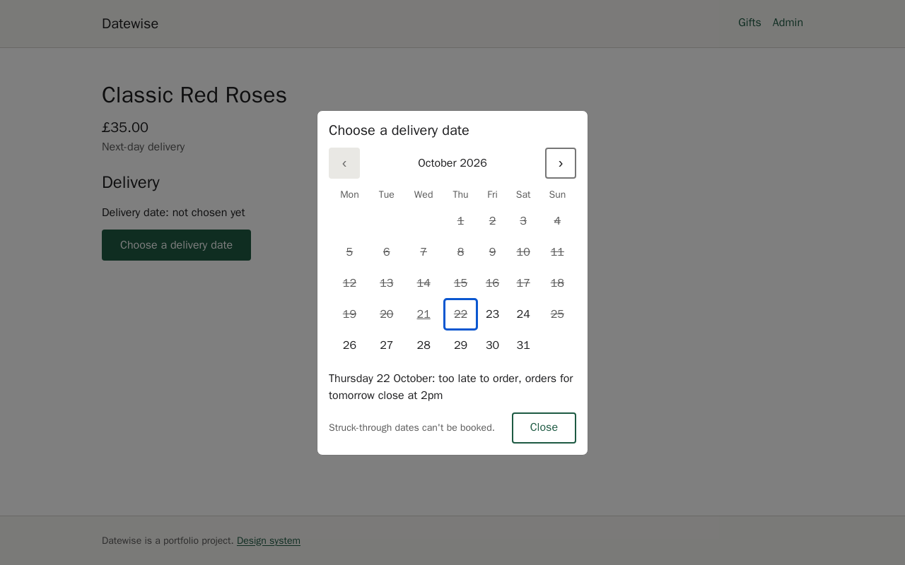
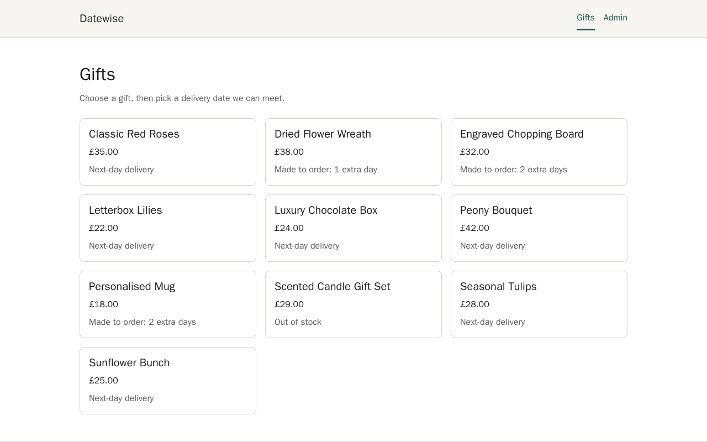
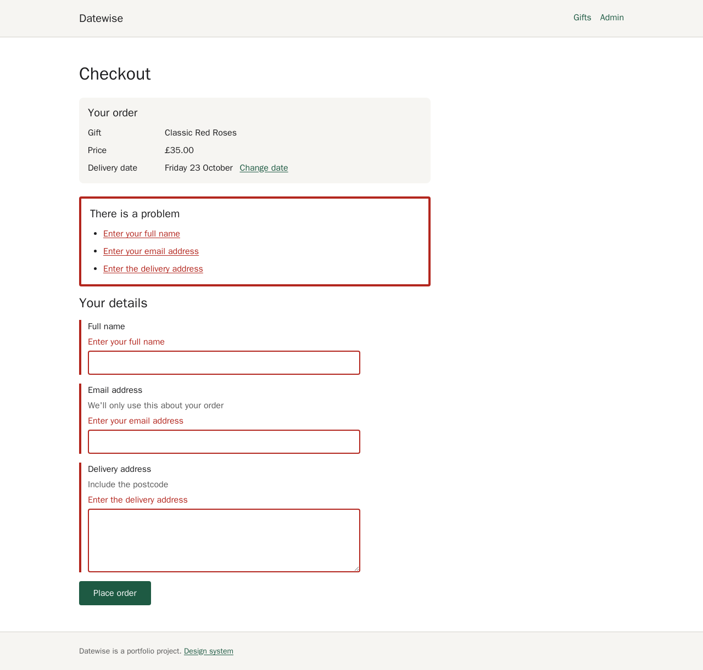
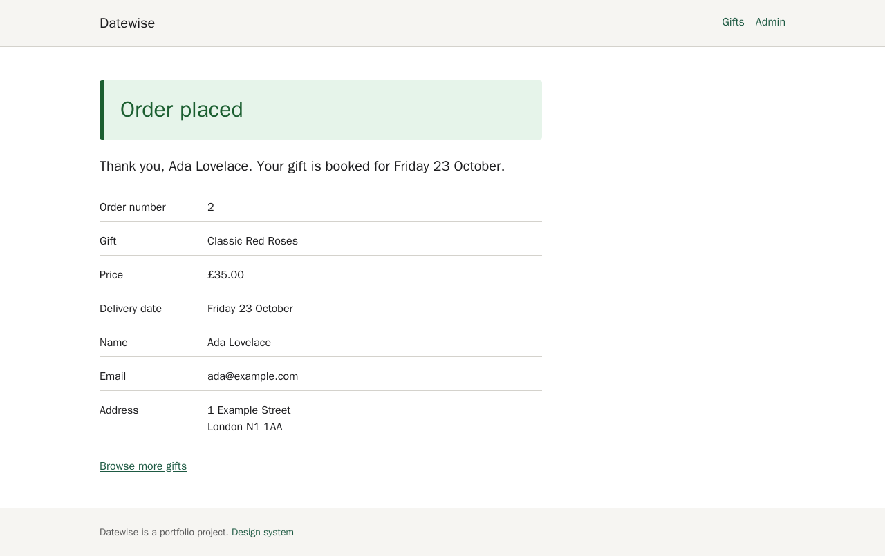
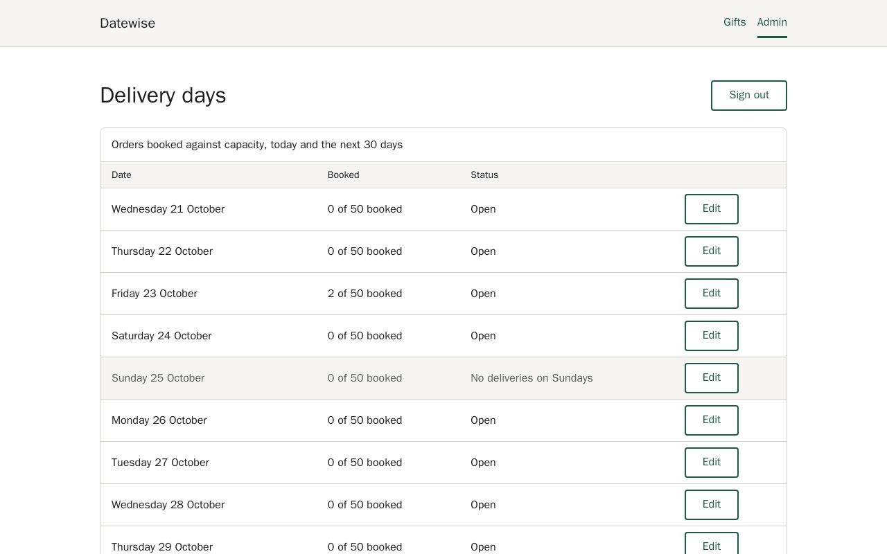
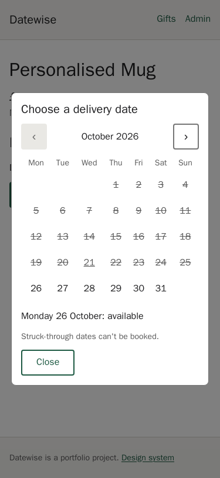
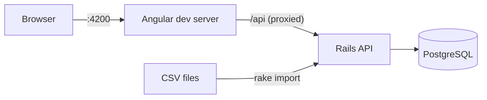

# Datewise

A delivery-date booking service for an online gift shop. A customer picks a gift and sees only the delivery dates the business can actually meet. Behind that one date picker sit real rules: order cutoffs, courier capacity per day, bank holidays, lead times and stock.

A Rails 7 API decides which dates are available, and an Angular 18 app shows them in an accessible date picker that says *why* a date can't be booked.



## What it does

- **Gift list and product pages**, with the price and how soon each gift can arrive
- **A date picker** following the WAI-ARIA date picker dialog pattern. Unavailable dates are struck through, and a screen reader hears the reason, for example "Saturday 14 November, fully booked"
- **Checkout** with an error summary linked to each field. The server re-checks the date under a database lock before saving, so the last slot can't be double-booked
- **Order confirmation**
- **An admin view** of each day's orders against capacity, where staff can close or reopen a day or change its capacity
- **A CSV import task** for products and bank holidays that reports every rejected row with its line number

| Gifts | Checkout | Confirmation |
| --- | --- | --- |
|  |  |  |

| Admin | Phone |
| --- | --- |
|  |  |

## Run it

Needs Docker only.

```bash
docker compose up
```

- Web app: http://localhost:4200 (the admin token is `change-me`)
- API: http://localhost:3000 (health check at `/up`)

The first start creates the database and seeds 10 sample products and the England and Wales bank holidays for 2026 and 2027. To change the database credentials or the admin token, copy `.env.example` to `.env`.

## Tests

Every push runs three CI jobs in parallel: `api`, `web` and `e2e`.

```bash
# API: RSpec and Rubocop
docker compose run --rm -e RAILS_ENV=test api bash -c "bin/rails db:create db:schema:load && bundle exec rspec"
docker compose run --rm api bundle exec rubocop

# Web: Jest (with axe on every component), ESLint and the production build
docker compose run --rm web npm test
docker compose run --rm web npm run lint
docker compose run --rm web npm run build

# End to end: Playwright against the running stack, the same way as CI
docker compose up -d
docker compose --profile e2e run --rm e2e
```

RSpec measures coverage with SimpleCov and fails below 90% of lines. Coverage is currently 100% of branches and 99–100% of lines (CI loads every file up front, so the unused `ApplicationJob` boilerplate counts as covered there but not locally); CI shows the figures in each run's summary and keeps the HTML report as an artifact.

The end-to-end tests:
- place a whole order using only the keyboard, including Tab staying inside the date picker dialog and Escape returning focus
- close a day in admin and check the customer sees it as unavailable
- run axe on every page

Any serious or critical accessibility violation fails the build.

## How availability is decided

A date is available only if every rule passes. When one fails, the API returns the first failing reason, and the picker explains it.

| # | Rule | Reason |
| --- | --- | --- |
| 1 | No dates in the past or today | `past` |
| 2 | Orders for tomorrow close at 14:00 UK time; after that, the earliest date is the day after tomorrow | `after_cutoff` |
| 3 | No delivery on Sundays or UK bank holidays | `closed` |
| 4 | An admin can close any date | `closed` |
| 5 | Each date has a capacity (default 50); a full date is unavailable | `fully_booked` |
| 6 | Made-to-order gifts add their lead time after the earliest normal date | `lead_time` |
| 7 | A gift with no stock has no dates | `out_of_stock` |
| 8 | Bookings go up to 30 days ahead | `too_far` |

The rules live in one plain Ruby class, [`AvailabilityCalculator`](api/app/services/availability_calculator.rb), with one line per rule. It never reads the clock or the database: the current time and the data are passed in. That's why its specs can test either side of 14:00 and both clock changes with plain values.

## Architecture



Two apps in one repo, [`api/`](api) and [`web/`](web), run together with Docker Compose. The browser never decides whether a date is available; it only shows the API's answer.

## Design decisions

- **The last slot can't be double-booked.** [`OrderBooking`](api/app/services/order_booking.rb) creates the date's `delivery_days` row if it's missing (`INSERT … ON CONFLICT DO NOTHING`), then locks it with `SELECT … FOR UPDATE`, then locks the product. Inside that one transaction it re-runs every rule before saving.
  - The locks are always taken in the same order, so two bookings can't deadlock.
  - A concurrency spec books from 8 threads at once and expects exactly one winner. Removing either lock makes it fail.
- **Dates are strings, not `Date` objects, in the browser.** The picker works on `YYYY-MM-DD` strings with UTC arithmetic, so a clock change can never shift a day. Its tests pass in London, Los Angeles and Auckland time zones.
- **There's no "get order by id" endpoint.** It would let anyone read other customers' names and addresses by guessing numbers. The confirmation page receives the order through the navigation instead.
- **The dev server proxies `/api` to Rails.** The app only talks to its own origin, which lets Playwright run in a container next to the stack. As a side effect, every browser shares one IP for the orders rate limit (10 a minute) in development.
- **Bad input is a clear error, never a guess.** Malformed dates are a 400, field errors are a 422 with details, and a date that has just gone is a 422 with the reason.

## Accessibility

- Semantic HTML first (real buttons, labels, tables, headings in order), with ARIA only where HTML has none.
- The date picker follows the WAI-ARIA date picker dialog pattern:
  - arrow keys move by day and week, Page Up and Page Down by month, Home and End to the ends of the week
  - Enter chooses, and Escape closes
  - focus returns to the button that opened it
- Unavailable dates are `aria-disabled`, and their reason is read out and written under the calendar, so nothing relies on colour alone.
- Form errors are linked to their fields and summarised at the top, and the summary takes focus.
- Focus moves to each new page's heading after navigation, and a skip link goes to the main content.
- Colour tokens are checked for 4.5:1 contrast by a test, and axe checks contrast in a real browser.
- Everything works at 320px wide.

The design-system components are all shown, in every state, at `/design-system`.

## Project layout

```text
api/                Rails 7 API
  app/services/     AvailabilityCalculator, OrderBooking, CSV importers
  db/seeds/         Sample products and bank holidays (with deliberately bad rows)
web/                Angular 18 app
  src/app/ui/       Design system: button, card, field, alert, error summary, skeleton, date picker
  src/app/pages/    Gift list, product, checkout, confirmation, admin, design system
  src/styles/       SASS tokens and global styles
e2e/                Playwright journeys and axe checks
docs/               Spec, AI log and screenshots
```

## Importing data

```bash
docker compose exec api bin/rails "datewise:import[db/seeds/products.csv]"
docker compose exec api bin/rails "datewise:import_holidays[db/seeds/bank_holidays.csv]"
```

Each command prints a summary such as `10 imported, 0 duplicates, 2 rejected`, then the line number and reason for every rejected row. Rows whose slug or date already exists are skipped, so re-running is safe. `products.csv` has two deliberately bad rows.

## API

| Method and path | What it does |
| --- | --- |
| `GET /api/products` | List products |
| `GET /api/products/:slug` | One product |
| `GET /api/products/:slug/availability?from=&to=` | Each date with `available` and, if not, `reason` (default: tomorrow to 30 days ahead, at most 62 days) |
| `POST /api/orders` | Re-checks the date under a row lock, then 201, or 422 with `reason` or field `details` |
| `GET /api/admin/days?from=&to=` | Orders booked against capacity per day |
| `PATCH /api/admin/days/:date` | Close or reopen a day, or change its capacity |

Admin requests need `Authorization: Bearer $ADMIN_TOKEN`. `POST /api/orders` is limited to 10 requests a minute per IP.

## Built with Claude Code

This project was built with [Claude Code](https://claude.com/claude-code), working from a written [spec](docs/SPEC.md) and the rules in [`CLAUDE.md`](CLAUDE.md):
- plan first, and wait for approval
- write the failing test first
- make one small change at a time, with the tests run before it's called done

Every change was reviewed. [docs/ai-log.md](docs/ai-log.md) records where AI was used and why, milestone by milestone, including the bugs the tests caught along the way.

## Licence

[MIT](LICENSE)
